Preheat oven to 175°C

| 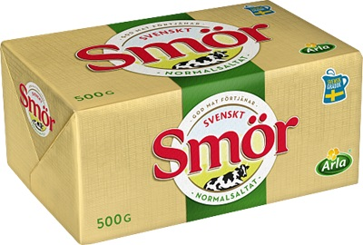{:height="100px"} | 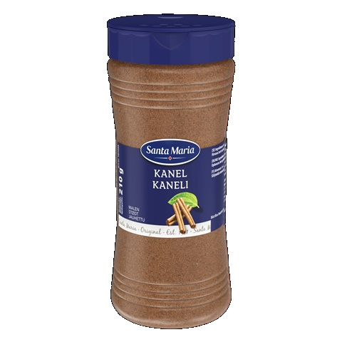{:height="100px"} | 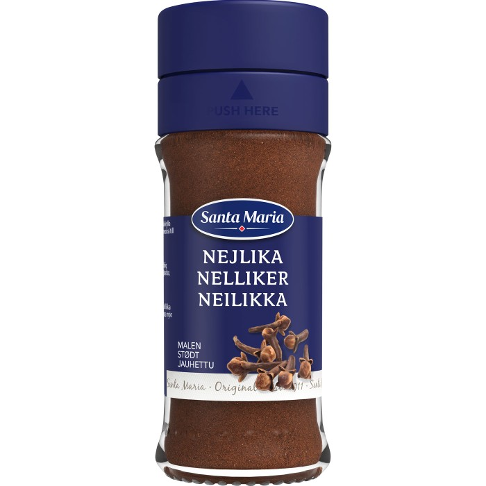{:height="100px"} |
| 200 g butter | 2 tablespoons cinnamon | 1 tablespoon ground cloves |
| 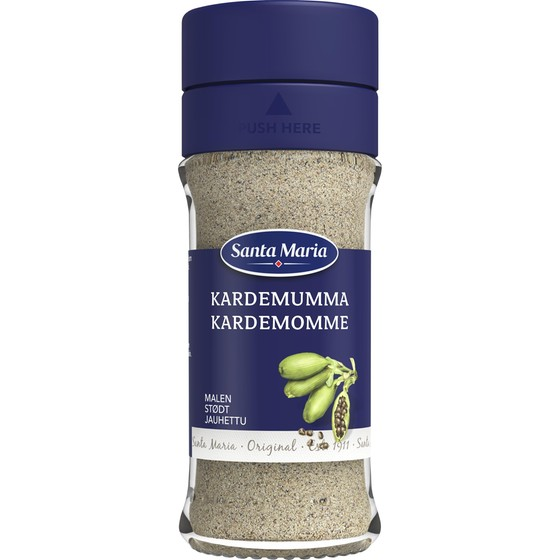{:height="100px"} | 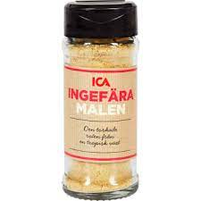{:height="100px"} | {:height="100px"} |
| 2 tablespoons cardamom | 1 tablespoon ginger | 4 eggs |
| 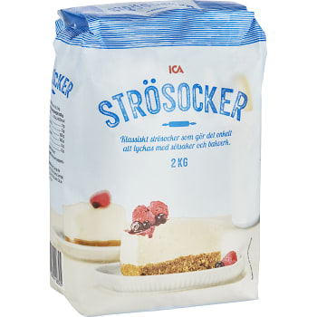{:height="100px"} | 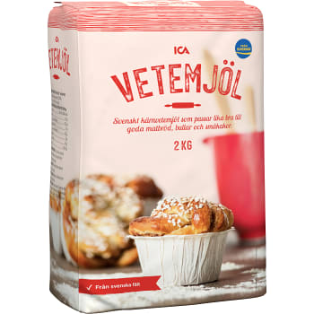{:height="100px"} | 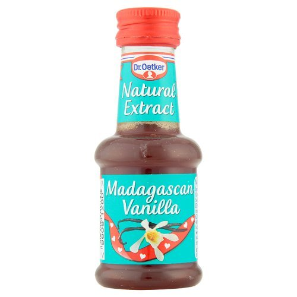{:height="100px"} |
| 360 g sugar | 300 g plain flour | 1 teaspoon vanilla |
| 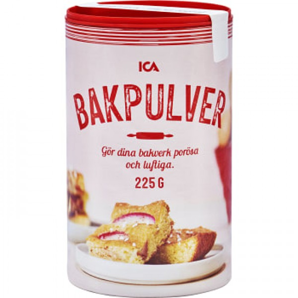{:height="100px"} | 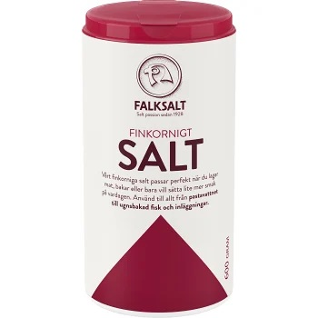{:height="100px"} | 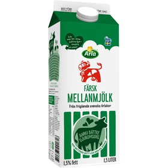{:height="100px"} |
| 2 teaspoons baking powder | 1 pinch salt | 200 ml milk |

Method for gingerbread:
1. Melt butter and add all spices.
2. Whisk eggs and sugar until they are white and fluffy.
3. Fold in flour, vanilla, baking powder and salt.
4. Add milk to the cooled butter mix then fold in to the other mixture.
5. Spread into a lined baking tin and bake for 30 minutes.

| {:height="100px"} | 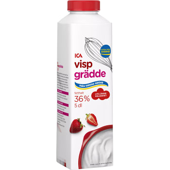{:height="100px"} | 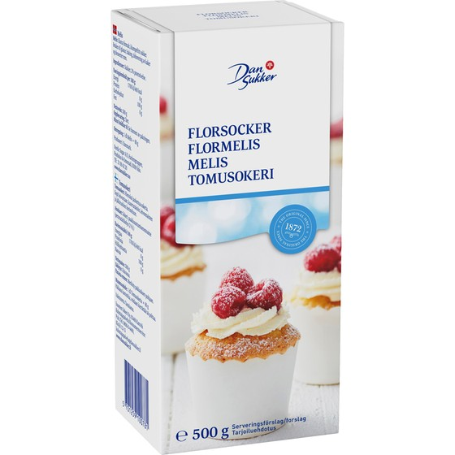{:height="100px"} |
| 500 g mascarpone | 250 ml whipping cream | 180 g icing sugar |
| {:height="100px"} |  |  |
| 0.5 teaspoons vanilla |  |  |

Method for frosting:
1. Beat together mascarpone and cream.
2. Fold in icing sugar and vanilla.
3. Spread over top once it has completely cooled.

Recipe from: https://mykitchenstories.se/mjuk-pepparkaka-i-langpanna-med-mascarponefrosting/